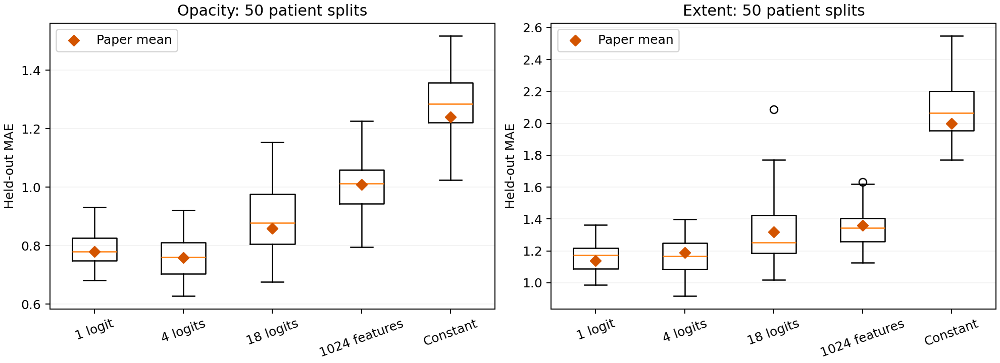
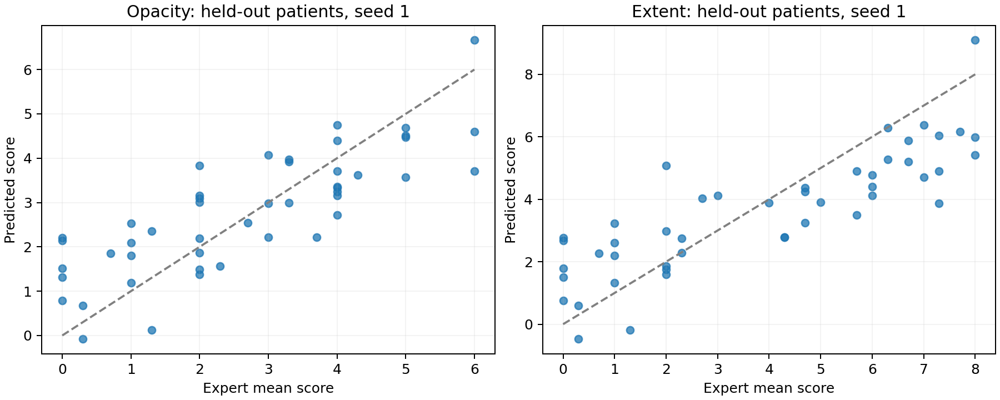

# Cohen et al. (2020)：COVID 胸片严重度评分复现

论文：**Predicting COVID-19 Pneumonia Severity on Chest X-ray With Deep Learning**，Cureus 12(7): e9448，DOI [10.7759/cureus.9448](https://doi.org/10.7759/cureus.9448)。本目录完成 **Part I 的完整 Table 1 实验**：94 张评分胸片、65 位患者、两个目标、五种方案、50 次患者分组划分，共 500 次回归拟合。

**实际结果支持原文的主要趋势，数值接近但未逐位一致。** 单一 Lung Opacity 特征的 opacity MAE 为 0.79，原文为 0.78；extent MAE 为 1.16，原文为 1.14。本次全部数据、权重、依赖和患者划分均已保存。本机 CPU 完成正式脚本实验约 44 秒，另行真实运行了原作者评估函数并核对全部 500 次拟合的结果。

## 1. 从哪里开始

- 想理解：打开 [reproduction.ipynb](reproduction.ipynb)。它包含中文说明、原作者的 `evaluate` 函数和已经真实执行的输出。
- 想看结果：打开 [results/table1.csv](results/table1.csv) 或带原文数值及差值的 [results/table1_comparison.csv](results/table1_comparison.csv)。
- 想重跑：使用 [reproduce.py](reproduce.py)。原始 notebook 另存于 [sources/covid-severity__xray_covid_eval.ipynb](sources/covid-severity__xray_covid_eval.ipynb)。

在 PowerShell 中进入本目录后运行：

```powershell
.\.venv\Scripts\python.exe .\reproduce.py run
```

首次完整运行已完成。重跑会校验数据与权重的 SHA-256，并复用与代码、数据及依赖版本一致的冻结特征缓存。修改这些输入后会重新提取特征。每次仍执行 50 次患者划分和全部 500 次回归，覆盖本目录的结果文件；需要保存另一版本的实验时先复制 `results/`。

从其他机器重新安装（Python 3.12；普通 `python` 必须指向该版本）：

```powershell
python -m venv .venv
.\.venv\Scripts\python.exe -m pip install -r requirements.lock.txt --extra-index-url https://download.pytorch.org/whl/cpu
.\.venv\Scripts\python.exe reproduce.py prepare
.\.venv\Scripts\python.exe reproduce.py run
```

`requirements.txt` 固定核心依赖，`requirements.lock.txt` 固定本次全部依赖。Notebook 用相同 `.venv` 解释器打开；如果编辑器提示安装 notebook kernel，按其提示安装 `ipykernel`。命令行复现本身不依赖 Jupyter。

## 2. 方法：模型在学习什么


DenseNet 已在七个非 COVID 胸片数据集上预训练。本实验冻结它，学习的是特征到专家严重度分数的线性映射。无需下载七个预训练数据集，也无需重新训练 CNN。

两个目标分别训练：

| 目标 | CSV 列 | 范围 | 含义 |
| --- | --- | --- | --- |
| Opacity | `opacity_mean` | 0–6 | 三位专家的不透明度评分均值 |
| Geographic extent | `geographic_mean` | 0–8 | 三位专家的病变范围评分均值 |

五种输入方案：

| 代码名称 | 输入 | 有效回归参数 |
| --- | --- | --- |
| `lung_opacity` | DenseNet 的 Lung Opacity 原始 logit | 1 个系数 + 截距 |
| `four_logits` | Lung Opacity、Pneumonia、Infiltration、Consolidation | 4 个系数 + 截距 |
| `eighteen_logits` | 全部 18 个原始 logits | 18 个系数 + 截距 |
| `intermediate_features` | ReLU + 全局均值池化后的 1024 维向量 | 1024 个系数 + 截距 |
| `constant` | 常数基线，预测训练集标签均值 | 仅截距 |

**Lung Opacity logit 是输入特征，`opacity_mean` 是专家给出的目标标签。** 两者名称相似，不能混为一谈。取 logits 时关闭 sigmoid 和 operating-point normalization。

预处理严格沿用历史代码规则：读取图像第一通道；用 `(2 * (pixel / 255) - 1) * 1024` 归一化；中心裁成正方形；使用 skimage 缩放至 `(1,224,224)`。图像和特征使用 float32。没有增强、特征标准化、正则化或预测裁剪。

## 3. 为什么必须按患者划分

同一患者可能有多张不同时间点的图像。逐图随机划分会让训练集和测试集共享患者特征。本次用原作者的 `GroupShuffleSplit(train_size=0.5, test_size=0.5, random_state=seed)`，seed 为 0–49。50/50 是患者比例，图像数量不一定相等。同一 seed 下，两个目标与五种方法共用同一个划分。

每个划分都检查患者集合互不相交，具体患者和图像索引保存在 [results/splits.json](results/splits.json)。患者 ID 保留 pandas 从历史元数据读入的数值类型；转成字符串会改变排序，从而改变固定 seed 对应的划分。

每次分别计算 Pearson r、R²、MAE、MSE，再汇总 50 次结果，采用样本标准差 `ddof=1`，与作者 pandas 汇总一致。**这里的标准差是划分波动，不是置信区间。** 各次划分共享数据，不能把 50 次当作 50 个独立数据集进行普通独立样本显著性检验。

## 4. 实际 Table 1 结果

以下为本次实验的均值 ± 标准差。

| 目标 | 输入 | Pearson r | R² | MAE | MSE |
| --- | --- | --- | --- | --- | --- |
| Opacity | 1 logit | 0.79 ± 0.04 | 0.59 ± 0.07 | 0.79 ± 0.06 | 0.89 ± 0.12 |
| Opacity | 4 logits | 0.80 ± 0.04 | 0.60 ± 0.07 | 0.76 ± 0.07 | 0.88 ± 0.15 |
| Opacity | 18 logits | 0.73 ± 0.06 | 0.42 ± 0.16 | 0.90 ± 0.12 | 1.28 ± 0.34 |
| Opacity | 1024 features | 0.68 ± 0.08 | 0.29 ± 0.17 | 1.01 ± 0.09 | 1.55 ± 0.29 |
| Opacity | Constant | 0.00 ± 0.00* | −0.08 ± 0.10 | 1.29 ± 0.10 | 2.40 ± 0.37 |
| Extent | 1 logit | 0.81 ± 0.04 | 0.60 ± 0.08 | 1.16 ± 0.10 | 2.15 ± 0.33 |
| Extent | 4 logits | 0.81 ± 0.03 | 0.61 ± 0.07 | 1.17 ± 0.12 | 2.12 ± 0.37 |
| Extent | 18 logits | 0.77 ± 0.06 | 0.50 ± 0.19 | 1.31 ± 0.20 | 2.72 ± 0.92 |
| Extent | 1024 features | 0.74 ± 0.08 | 0.47 ± 0.15 | 1.34 ± 0.13 | 2.86 ± 0.60 |
| Extent | Constant | 0.00 ± 0.00* | −0.09 ± 0.09 | 2.07 ± 0.17 | 5.97 ± 0.90 |

\* 常数预测的 Pearson 在数学上未定义。为了与论文对照，显式采用论文展示值 0；不能解释为测得的相关性为 0。原 notebook 的 baseline 参数数写成 `1+1`，但其输入恒为零，有效参数只有截距，论文写 `0+1`。

单特征主要结果与原文的比较：

| 目标 | 本次 Pearson r | 论文 Pearson r | 本次 MAE | 论文 MAE |
| --- | --- | --- | --- | --- |
| Opacity | 0.79 ± 0.04 | 0.78 ± 0.04 | 0.79 ± 0.06 | 0.78 ± 0.05 |
| Extent | 0.81 ± 0.04 | 0.80 ± 0.05 | 1.16 ± 0.10 | 1.14 ± 0.11 |



橙色菱形是论文均值，箱线图是本次 50 次划分的分布。不能仅凭菱形落在箱体或须内，就认定复现通过或两种方法等效。



散点图固定使用原 notebook 示例的 seed 1，没有挑选最佳划分。因为原评估没有裁剪预测，个别预测会超出评分范围；这应保留在复现中，后续改进再单独评估裁剪效果。

## 5. 数据版本与已知复现差异

官方最新 metadata 无法直接恢复原实验：94 个评分文件名只匹配到 93 个；其中 82 个仍标 PA，8 个为 AP，3 个为 AP Supine，另一个 `ciaa199.pdf-001-c.png` 缺失。完整新版元数据的患者 ID 列会读为文本，旧快照则为整数；匹配到的 93 个样本编号本身未改变。对最新数据简单筛 PA 会改变论文样本，使用文本编号则会改变固定 seed 的组排序。

因此本次固定图像与元数据到历史提交 **`d929fa7ba8ded7aa5233cbd23b7685f3677592db`**：它有 199 张 PA 胸片，与作者已保存 notebook 一致，且全部 94 个评分文件名可匹配，来自 65 位患者。评分表独立固定到 **`78543292f8b01d5e0ed1d0e15dce71949f0657bb`**。该表的 geographic 标签均值 3.336170、标准差 2.369785，与原 notebook 保存的分布一致。

**这是对历史样本的可追溯重建。论文和作者代码没有明确固定数据 commit，不能声称已证明它就是论文最终实验的数据版本。** 在今天的修订 metadata 中，部分视角标签不同；报告应说明这一历史标注与后续修订的差异。

原始权重资产发布于 2020 年 3 月，2020 年 torchxrayvision 源码与当前源码使用同一个下载 URL。本次文件 28,382,008 字节，SHA-256：

```text
56524913dd16a906422e8d8b66a7a5c46be1d82eb7ac012d8103776f1aa68899
```

代码和运行适配：

- 官方 notebook 固定于 `5571e45b49bdba69161268f8bfaea90d698f9f55`；全部来源见 [sources/manifest.json](sources/manifest.json)。
- 原 notebook 的路径、`num_workers=64`、`DataFrame.append`、`np.float` 和老式权重加载需要现代化兼容。复现 notebook 原样保留 `evaluate` 函数，其它路径与收集方式已适配。
- 正式脚本只提取有评分的 94 张图，CNN 处于 eval 且冻结；没有训练中批归一化的样本互相影响。批量大小 16，CPU 执行；原 notebook 批量大小 32。
- 采用现代 Python 3.12.14、PyTorch 2.7.1 CPU、torchxrayvision 1.4.0、scikit-learn 1.3.2 等。高维欠定回归和图像缩放可能受数值库版本影响；未重建原作者的未锁定历史环境。
- 官方 notebook 已保存的 extent 结果为单特征 MAE **1.16 ± 0.10**、r **0.81 ± 0.04**；这些值本来就与论文 **1.14 ± 0.11**、**0.80 ± 0.05** 有差异。本次接近其代码保存结果。
- 论文没有规定复现误差阈值，本次如实报告所有数值和差值，不以调 seed、删样本或修改预处理追求表格对齐。

可以在汇报中写：

> 我们按照作者的冻结特征与患者分组评估流程，复现了 Table 1 的五种方案和两种评分任务。主要数值接近论文，少量相关输出在小样本上的表现优于高维特征，支持原文的主要趋势。逐位数值存在差异；作者没有固定数据版本，其 notebook 保存结果也与论文略有不同，因此我们公开历史数据快照、软件版本、每次划分及完整指标，而不声称获得完全相同的表格。

## 6. 已执行的检查与输出

- 94 个独立评分文件名、65 位患者、历史 PA 标签和目标范围检查。
- 每份下载文件的 SHA-256 验证，包括图像、metadata、评分表和权重。
- 特征形状 `(94,1024)`、logit 形状 `(94,18)`、有限值检查；分类头与模型原始 forward 输出核对。
- 50 次划分均无患者交叉；所有方法共用对应 seed 的划分。
- 原作者 `evaluate` 函数真实运行 500 次，四项指标与脚本逐项一致（容差 `1e-7`）。
- 独立用保存的测试预测，重算 seed 1 下全部十个模型的 MAE、MSE、R² 和非恒定 Pearson，并核对常数基线确为训练集均值。
- 图表已打开检查，文字和数据没有截断。

| 文件 | 用途 |
| --- | --- |
| `results/cohort.csv` | 实际 94 张样本、患者、历史元数据及两个评分 |
| `data/download_manifest.json` | 数据和权重的下载 URL、大小、SHA-256 |
| `results/data_audit.json` | 数据快照与样本检查 |
| `results/metadata_changes.csv` | 11 个视角标注变更与 1 个缺失文件的历史/当前对照 |
| `results/splits.json` | 每个 seed 的训练/测试患者和图像索引 |
| `results/features.npz` | 冻结的 1024 维特征与 18 维 logits |
| `results/metrics_per_split.csv` | 500 次拟合的完整四项指标 |
| `results/test_predictions.csv` | 每次测试集的逐图真实值与预测 |
| `results/table1.csv` | 便于阅读的均值与标准差表 |
| `results/table1_comparison.csv` | 未四舍五入结果、论文值、逐项差值 |
| `results/author_notebook_metrics.csv` | 原作者函数实际执行结果 |
| `results/author_notebook_table1.csv` | 原作者函数汇总表 |
| `results/environment.json` | 实际 Python、依赖及代码/数据提交版本 |
| `results/run_summary.json` | 运行耗时、拟合数、权重校验与检查状态 |

## 7. 课程范围与下一步

本阶段完成了选定的 **Part I：Table 1 复现**，并提供固定 seed 的测试集散点图。论文其余 t-SNE、梯度可视化，以及 RALO 外部验证未在这一阶段执行。

按目录中的 DSA5206 Type-2 指引，Part II 还需要课堂 checklist 的批判性评价，以及另一种方法的对照。推荐下一步选择 **Ridge 回归**，保留相同冻结特征与外层患者划分，正则化强度只在训练患者内部交叉验证；这样能针对高维特征在小样本上过拟合的问题提出明确假设。是否优于原方法应依据实验结果判断。

RALO 可作为后续外部验证，但原 opacity 为 0–6，RALO 为 0–8，且定义不同。线性缩放并不能证明两种评分含义相同；外部验证也不能替代课程要求的方法对照。

## 8. 原始来源

- [论文 arXiv 版本](https://arxiv.org/abs/2005.11856)；本地发表版：上一级目录 `BBB_Duong_Pneumonia_xray.pdf`，Table 1 在第 4 页。
- [官方 covid-severity 仓库](https://github.com/mlmed/covid-severity)
- [固定的原始评估 notebook](https://github.com/mlmed/covid-severity/blob/5571e45b49bdba69161268f8bfaea90d698f9f55/xray_covid_eval.ipynb)
- [历史数据 metadata](https://github.com/ieee8023/covid-chestxray-dataset/blob/d929fa7ba8ded7aa5233cbd23b7685f3677592db/metadata.csv)
- [固定的评分表](https://github.com/ieee8023/covid-chestxray-dataset/blob/78543292f8b01d5e0ed1d0e15dce71949f0657bb/annotations/covid-severity-scores.csv)
- [2020 年权重映射源码](https://github.com/mlmed/torchxrayvision/blob/d6fc63ea561daf35e049d57966788016254899e2/torchxrayvision/models.py)
- [2020 年数据加载与预处理源码](https://github.com/mlmed/torchxrayvision/blob/d6fc63ea561daf35e049d57966788016254899e2/torchxrayvision/datasets.py)
- [官方 v1 权重发布](https://github.com/mlmed/torchxrayvision/releases/tag/v1)
